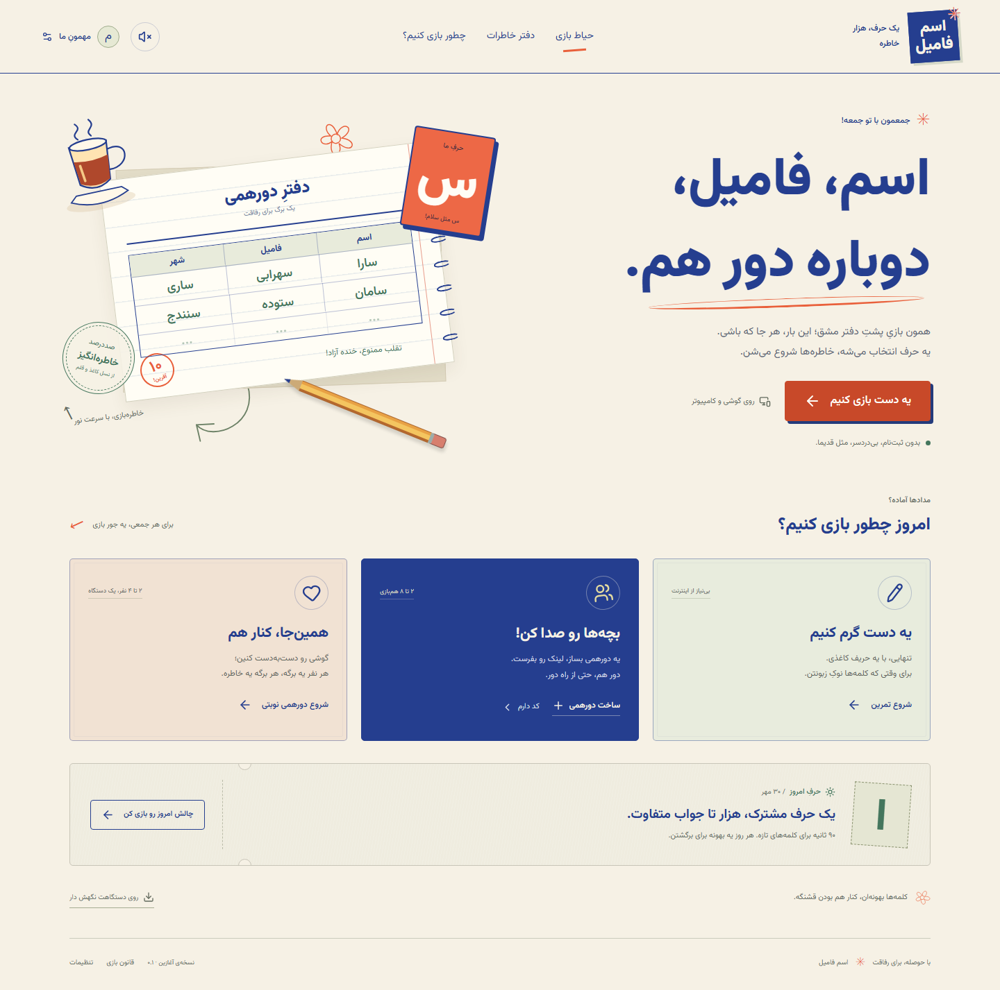

# اسم فامیل

**یک حرف، هزار خاطره.** A Persian-first take on the familiar Iranian word game, with an original school-notebook and courtyard identity. Built for phones and computers with React, TypeScript, Vite, and a real Socket.IO room server.

This repository contains the **first playable phase**, including the complete writing → review → scoring → result loop. It is a development prototype with a production roadmap, rather than a released multiplayer service or signed native app.



## Play locally

Requires **Node.js 22.12+** and npm.

```sh
npm install
npm run dev
```

Open **http://localhost:5173**. The command starts Vite and the Node game server together; Vite proxies game connections to port 3001.

For a private match, create a room, open a second browser tab/window, join with its code, and start from the host. On another device on the same network, use `http://<computer-LAN-IP>:5173` and allow the development port through your firewall. `localhost` on a phone refers to the phone, not your computer. PWA installation/offline caching requires HTTPS or localhost; an ordinary HTTP LAN address is only a development preview.

## Included gameplay

| Mode | Behavior |
| --- | --- |
| **یه دست گرم کنیم** | Solo practice against an explicitly labeled computer “paper rival”; its answers are chosen before your answers are known. |
| **حرفِ امروز** | One 90-second challenge based on the date in `Asia/Tehran`, with the same deterministic letter and paper rival for that date. Personal results only. |
| **دورهمی نوبتی** | 2–4 players share one device, with a concealed handoff and equal individual timers. This is an adapted turn-based mode. |
| **دورهمی آنلاین** | Private invite-code/link rooms for up to 8 participants, with server-owned letters, deadlines, draft saving, stop, review voting, and scores. |

- Six categories: **اسم، فامیل، شهر، غذا، میوه، حیوان**.
- 14 curated starter letters and **339 answer entries**, including spelling variants. This is a finite original starter vocabulary, not an exhaustive Persian dictionary.
- Choose 1, 3, or 5 rounds and 60, 90, or 120 seconds per round; the daily challenge uses its fixed settings.
- Accepted unique answer: **10** points; accepted duplicate: **5** each; empty, invalid, or unresolved answer: **0**. The traditional optional 20-point variant is researched but is not implemented in this build.
- Matching handles Persian/Arabic ی and ک, alef variants including آ, vowel marks, spacing, half-spaces, and direction controls while retaining the displayed spelling. Different written synonyms are not automatically merged.
- Unknown, well-formed answers with the right initial go to manual review. Local players decide together; online answers need a majority of the **other participants**, with no self-vote. Unresolved review earns zero when the host advances.
- In online play, any participant who fills all six fields can call «استپ»; the server freezes accepted drafts. The deadline also ends the round. Late writes are rejected.
- Local notebook history/preferences, optional synthesized sound, reduced-motion support, responsive RTL screens, and self-hosted Vazirmatn fonts.
- Resume credentials allow a tab to reconnect while its room still exists. Host responsibilities move to a connected participant when the host disconnects.

Practice, the daily page, and pass-and-play can work offline **after the built application has loaded successfully and its service worker has cached the assets**. Online rooms always need the running server. Browser storage holds local history and settings; clearing site data removes them.

## Build and run the application server

```sh
npm run build
npm start
```

Open **http://localhost:3001**. The Node server serves `dist/` and the multiplayer connection from the same origin. `npm start` runs the TypeScript server through `tsx`, so its runtime dependency is included in production installs. `HOST` and `PORT` configure the listening address; defaults are `0.0.0.0` and `3001`.

Use HTTPS and an appropriately configured reverse proxy for an internet deployment. `npm run preview` previews the client build only; it is not a substitute for the multiplayer server.

The client defaults to its current origin. `VITE_SERVER_URL` can specify another backend URL at **build time** through a local `.env` file:

```dotenv
VITE_SERVER_URL=https://your-game-backend.example
```

The game client uses WebSockets. The default server accepts cross-origin WebSocket handshakes, including a separate frontend or native shell; session identity uses explicit private tokens rather than cookies. Use a reachable HTTPS/WSS backend for release. Cross-origin HTTP polling is not enabled. Apply any deployment-specific browser Origin restrictions at your reverse proxy; an Origin check is not authentication.

## Checks

```sh
npm run check
npm test
npm run build
npx playwright install chromium
npm run test:e2e
```

The test suites exercise Persian normalization, unknown-word handling, scoring/duplicates, letter selection, practice determinism, and actual server/client room behavior including privacy, authority, voting, deadlines, and reconnects. Browser checks cover complete matches, phone layouts, keyboard accessibility, and offline recovery. For WebKit, run `npx playwright install webkit` and `npm run test:e2e:webkit`. See the [measured validation and offline-test instructions](docs/VALIDATION.md) for current results and limits.

## Mobile packaging

`capacitor.config.ts` is prepared with app ID `ir.bazimazi.esfamil` and `dist` as the web output. **Android/iOS projects, signed binaries, native-device testing, and store releases are not included.**

When ready to initialize native projects:

```sh
npm install @capacitor/android@8.4.3 @capacitor/ios@8.4.3
npx cap add android
npx cap add ios
npm run build
npx cap sync
```

Add/open only the platform supported by your development machine: `npx cap open android` requires Android Studio and its SDK; iOS requires **macOS, Xcode, and Apple signing setup**. Rebuild and sync after web changes. See the official [Capacitor environment requirements](https://capacitorjs.com/docs/getting-started/environment-setup) and [platform installation workflow](https://capacitorjs.com/docs/getting-started).

Local modes can use packaged assets. Native online play needs a reachable backend and the WebSocket/HTTPS configuration described above. `localhost:3001` inside Android points to Android itself; the standard Android emulator reaches the host through `10.0.2.2`, and physical devices need a reachable LAN or hosted address. [Android emulator address reference](https://developer.android.com/studio/run/emulator-networking-address). HTTP may also need native cleartext policy changes; use HTTPS for a release. These native networking/lifecycle paths still need device validation. No desktop wrapper is built; desktop play currently uses the browser/PWA.

## Scope and next steps

The server is **single-process and in-memory**: restarting it loses rooms and online match state. There is guest-session identity, but no account authentication, durable database, public matchmaking, global leaderboard, payment system, or trusted ranked adjudication. Basic limits and validation do not establish production readiness. Social voting assumes a friendly group; players can collude, and the starter vocabulary needs further editorial coverage.

Before a public release, complete durable/idempotent recovery, operational/security review, moderation and appeals, measured load testing, expanded licensed vocabulary, real-device/accessibility testing, and native signing/distribution as applicable.

- [Game research and cross-platform study](docs/RESEARCH.md)
- [Comprehensive implementation and release plan](docs/IMPLEMENTATION_PLAN.md)
- [Validation results and reproduction](docs/VALIDATION.md)
- [Shared rules and vocabulary notes](shared/README.md)

## Source map and licensing

| Location | Responsibility |
| --- | --- |
| `src/` | React UI, original SVG illustrations, local modes, storage, audio, online client |
| `shared/game.ts` | Framework-free Persian rules, scoring, curated answers, practice/daily selection |
| `shared/protocol.ts` | Public/private room state and Socket.IO event types |
| `server/` | Authoritative rooms, validation, voting, deadlines, reconnect, static serving |
| `tests/` | Domain and real Socket.IO integration tests |
| `vite.config.ts` | Development proxy, build, manifest, service-worker cache |

Project code, original artwork, and authored starter vocabulary use the [MIT license](LICENSE). Fonts and icons retain their own licenses; see [third-party notices](THIRD_PARTY_NOTICES.md).
