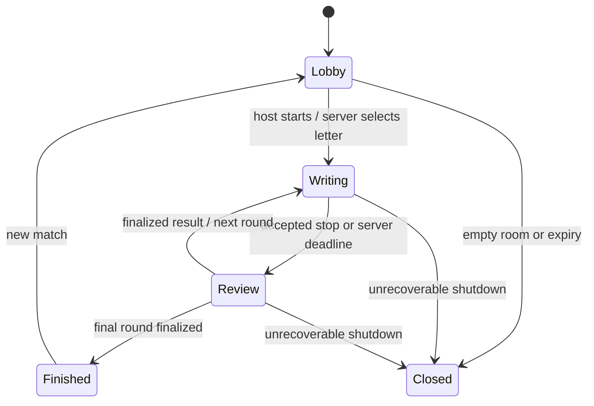

# اسم فامیل — implementation and release plan

Plan created **22 October 2026**, following [the game and technology research](RESEARCH.md). The product goal is an original, polished Persian word game that works well on phones and computers, preserves the familiar social ritual, and explains its decisions fairly.

This is a comprehensive roadmap, not a claim of a completed commercial launch. **The current code implements the first playable phase:** solo practice, a Tehran-date daily challenge, adapted pass-and-play, and private online rooms, with six categories, Persian normalization, review, scoring, and a responsive notebook interface. The [README](../README.md) records the delivered scope, local commands, and limitations; the roadmap below also contains proposed features that have not shipped. Native packages, production hosting, persistent accounts, exhaustive judging, and ranked play require later milestones and their stated release gates.

The initial build deliberately uses **0/5/10 scoring**, a finite 339-entry vocabulary, and explicit review of unfamiliar answers. The researched 20-point variant, semantic alias IDs, durable command replay, and ranked appeals are future work. Production service-worker behavior is provided by the PWA build, while native packaging currently consists of configuration rather than tested binaries. Verification commands in the README describe how to assess the current build without assuming every future release gate has been met.

## 1. Product contract

### First playable promise

A Persian-speaking player can open the game on a phone or computer, immediately understand its personality, practice a complete match, or create a private room for friends. They can write answers naturally, see when answers are saved, understand why a round stopped, compare answers, review uncertain words, and see a final result. Controls must work; decorative sections must not pretend that unavailable services are live.

### Principles that constrain implementation

1. **The notebook is the game.** The letter, timer, categories, handwriting fields, reveal, and scores take precedence over navigation and progression.
2. **Persian is the source design language.** Typography, RTL order, keyboard behavior, and copy are designed directly for Persian.
3. **Fairness is visible.** State the rule profile; explain every score; retain original answers; make overrides inspectable.
4. **Private answers stay private.** Do not put other players' drafts in the client payload during writing.
5. **A real human invitation should be easy.** No account wall before a friendly match; show room code/link and connection status.
6. **Competitive advantage is earned in play.** Optional monetization can be cosmetic; ranked matches never sell time, answers, or score multipliers.
7. **Connection loss is a designed state.** Preserve accepted work, attempt recovery, and explain when recovery is impossible.
8. **Polish must survive a small screen and reduced motion.** A beautiful desktop screenshot is insufficient.

### Modes and scope

| Mode/feature | Milestone 1 target | Production evolution |
| --- | --- | --- |
| Solo practice | Complete local round/match, honest finite-dictionary feedback | Personalized wordbook and difficulty selection |
| Private online room | Real multi-client lobby, shared letter/timer, private draft saving, reveal, review, final results | Durable sessions, operational resilience, host migration |
| Daily challenge | Personal deterministic practice if included; clearly unranked | Server-owned daily seed, submission validation, fair leaderboard |
| Public matchmaking | Not required for first playable | Moderation, abuse protection, queue and skill policy |
| Local pass-and-play | Optional adapted mode; never imply simultaneous privacy on one screen | Deliberate handoff flow and family playtesting |
| Native mobile/desktop | Responsive installable browser experience | Signed Capacitor/Tauri artifacts after device validation |
| Judging | Curated examples, normalization, explicit uncertain-answer review | Licensed broad content, moderation tooling, appeals |
| Accounts and progression | Local preferences/results where useful | Optional accounts, cloud history, privacy controls, cosmetics |
| Chat/voice | Not required | Add only after social value and moderation costs are understood |

## 2. Original art and interaction direction

Use **دفترِ حیاط — the courtyard notebook** as the creative thread. The game should feel like an afternoon gathering around a familiar school notebook: cream paper, cobalt handwriting ink, red margin lines, green courtyard or chalkboard tones, a blue pencil, small rubber stamps, and a restrained illustrated tea or plant detail. The identity should emerge from composition and materials rather than a standard dashboard with a Persian title.

### Screen composition

- **Home:** an expressive notebook cover or open page as the central play invitation; one strong primary action; secondary private-room/practice actions; a small daily-page story if implemented. Avoid visual competition from invented balances, fake live counts, or nonfunctional rewards.
- **Room setup:** a handwritten seating roster and concise rules strip. Expose rounds and duration. Present invite code in an isolated LTR region, with a working copy/share action and confirmation.
- **Writing:** a legible notebook answer area. The current letter is a strong typographic element, not a tiny chip. The timer remains visible. A clear «استوپ!» control has its own distinctive visual treatment and an understandable eligibility state.
- **Review:** reveal one coherent row/column group at a time. Label known, shared, uncertain, and rejected answers in words as well as color. Show score reasons next to points. Keep authors visible for friendly results, or deliberately anonymous in a later voting flow.
- **Final:** a paper certificate or stamped total and a compact round history. Offer another match and return to the courtyard. A future keepsake can collect memorable accepted answers.

### Motion and audio grammar

Use a small set of repeatable motions: notebook page entrance, pencil underline, brief stamp impact, measured score count, and a modest final celebration. Animate only transform/opacity for decorative elements when possible. No indefinite wobble beside an input. Do not shake the entire viewport for a rejected answer. Keep an instantaneous reduced-motion route to every final state.

Audio can use quiet pencil, page, stop-bell, and stamp cues after explicit interaction; provide a persistent mute preference. A haptic acknowledgement can be added in native wrappers. Sound and animation never carry the only indication that time has ended or an answer is invalid.

### Design acceptance criteria

- Recognizable as this game's notebook/courtyard identity without the logo.
- Readable Persian at narrow phone widths with the keyboard open and at large desktop widths.
- At least 44 px product touch targets and clear focus indicators.
- No text clipping at 200% zoom or when longer player names are present.
- No horizontal page overflow at 360 px viewport width; a tabular review may have a clearly bounded intentional scroll region.
- All buttons either execute a meaningful action or are omitted; future features are not presented as operational.
- Fonts and critical assets work without third-party CDNs. Any asset's license and attribution requirements are retained.

## 3. Architecture and repository boundaries

**Chosen direction:** a responsive React/TypeScript/Vite client with semantic DOM controls; a Node/TypeScript/Socket.IO authoritative room service; shared pure rules and protocol definitions. The [research comparison](RESEARCH.md#5-cross-platform-architecture-study) explains why this is suitable for a text/social game and when Flutter, Godot, Unity, Capacitor, or Tauri would be appropriate.

Suggested responsibilities, adaptable to the actual repository layout:

| Boundary | Responsibility | Must not own |
| --- | --- | --- |
| Client presentation | Navigation, inputs, focus, animation, accessible status, visible countdown | Authoritative score, other players' hidden drafts, accepted submission cutoff |
| Local practice adapter | In-browser practice state and personal history | Global ranking or fake online players |
| Shared game domain | Category IDs, normalization, deterministic validation/scoring, rule types | DOM, socket instances, environment secrets |
| Shared protocol | Typed commands, snapshots, public/private shape | Security guarantees based only on TypeScript types |
| Server room service | Membership, credentials, phases, letters, deadlines, drafts, review, scores | Client UI implementation |
| Persistence adapter, later | Sessions, match events, content versions, appeals | Trusting client-provided totals |

Keep a local-practice path independent of socket connection availability. Use a common result model and rule functions so practice and online scoring agree, but keep transport and authority separate. Components should consume domain state instead of duplicating scoring rules.

### State machine

The UI can have a short local letter-reveal animation, but it must not introduce an unofficial extra server phase or grant different writing time to different devices. Freeze membership and rule settings for an active match. A server transition must be atomic: only the first accepted stop/deadline finalizes a given round.

### Draft and stop ordering

Autosave the active player's private drafts during writing, with acknowledgements and a visible saved/saving/disconnected state. Use modest debouncing during typing, then flush before stop. Do not wait for every client to submit after someone else ends the round: that creates an opportunity to write late. Freeze the last drafts accepted by the server. Keep the last acknowledged draft on reconnect; show any unsent local text as unsent, not scored.

Before production online release, attach match/round IDs, command IDs, and revisions to mutations. A retry of `stop`, `vote`, or `next` must not cause a second transition. A delayed answer from round one must never mutate round two. The transport's type declarations must be complemented by runtime schema validation. Socket.IO's default delivery is at most once, and temporary recovery is not guaranteed; snapshots and idempotence remain application responsibilities. [Socket.IO delivery guarantees](https://socket.io/docs/v4/delivery-guarantees/), [connection recovery](https://socket.io/docs/v4/connection-state-recovery)

### Snapshot policy

Public snapshot: room code, host ID, phase, participants, connectivity, scores, filled-count indicators, rule configuration, current letter, deadline, and revealed results after writing ends. Private addition: the receiving participant's ID, resume credential, own accepted draft, and own vote state. Never broadcast a private resume credential or every player's private draft to a room.

Use a stable server participant ID, separate from ephemeral socket ID. Resume requires an unpredictable secret, not just knowing a player ID or room code. Define what happens if the same credential connects twice. Short room codes are invitation locators, not authentication credentials.

## 4. Rules and content implementation

### Domain functions

- Normalize Persian input into comparison keys while preserving display text.
- Apply the selected initial-letter family, including a declared ا/آ policy.
- Resolve aliases through category-aware content records.
- Return known/review/invalid with a reason and optional canonical concept ID.
- Group accepted duplicates per category and compute 0/5/10 plus the explicitly configured 20-point variant.
- Generate letters from a curated pool without repetition inside the match.
- Compute round and final totals deterministically; keep provisional and finalized scores distinct.

### Content work

Begin with a deliberately bounded hand-curated set for the enabled categories and letters. Ensure every generated letter has several plausible accepted answers in every core category. Track coverage and expose the dictionary's limited nature. Do not fill gaps by scraping or copying another game's unlicensed word database.

A later content pipeline should store source/evidence, aliases, canonical IDs, regional usage, category memberships, license, editor, and content version. Build an editorial review queue for false rejections and abuse reports. Rule/content versions must be recorded on a match so a future dictionary change does not silently rewrite a past result.

### Review policy

For the first online loop, make all uncertain answers visible and allow a declared social review policy. If the host can finalize unresolved answers, state that clearly before play and record the decision. Avoid presenting unreviewed unknown words as definitively wrong.

For a fuller vote design, define voter eligibility, whether authors vote on their own answers, quorum, ties, disconnected voters, deadline, and finalization. Review each normalized unique answer once per category. After a decision changes validity, recompute duplicates and the sole-valid-answer bonus across the entire category. Ranked review must not rely solely on a room majority that can collude.

## 5. Milestones and release gates

### Milestone 0 — research and foundation

Deliverables:

- Sourced game study, honest rule variants, platform decision, and this plan.
- Repository structure, package tooling, source control hygiene, and documented local commands.
- Shared domain/protocol model and original visual direction.

Exit gate: a developer can explain the loop, score a representative category by hand, identify what is private, and distinguish the first playable from the production roadmap.

### Milestone 1 — polished playable vertical slice

Deliverables:

- Original RTL home, setup, play, review, and final-result screens.
- Local practice with actual timer, answer editing, completion/stop, score reasons, and restart.
- Private online room creation/join with stable participant identity and real connected clients.
- Server-selected letter, shared deadline, private draft updates, atomic stop, reveal, scoring, and match progression.
- Known/unknown/invalid answer states and a transparent review mechanism.
- Responsive mobile/desktop layouts, keyboard navigation, reduced motion, and persistent local preferences.
- Manifest/icons and an honest offline strategy if a service worker is included.
- Domain tests and a real two-client online smoke test.
- README with setup commands, implemented features, in-memory limitations, and native/production follow-ups.

Exit gate: two independent browser clients complete a match; each sees only its own answers before reveal; scores match the documented rules; wrong-letter/empty inputs and stop permissions behave correctly; a new player can finish practice without explanation. Type checking, production build, meaningful tests, and visual review pass.

### Milestone 2 — dependable private-room beta

Deliverables:

- Durable room/session snapshots, replayable events or equivalent state recovery, and restart behavior.
- Idempotent mutation IDs, round revisions, bounded retries, robust resync, duplicate-connection handling.
- Explicit host-disconnect/migration and empty-room expiry policies.
- Server limits for rooms, participants, payload length, event rates, and stale sessions.
- Origin policy, hardened production configuration, TLS/reverse-proxy setup, no secrets in bundles or logs.
- Comprehensive uncertain-answer review with clear finalization and audit.
- Basic operational telemetry: room create/join failures, reconnect success, round completion, validation disputes, process health, and error reports without indiscriminate answer logging.
- Integration and end-to-end coverage for failures, timer races, disconnections, and unauthorized actions.

Exit gate: deliberate network interruptions recover safely; stale writes are rejected; restart behavior matches the documented promise; no cross-player private-data leakage; load tests meet an explicitly stated beta capacity; backup/restore and rollback are rehearsed for any persisted data.

### Milestone 3 — content and inclusive design beta

Deliverables:

- Expanded licensed Persian answer coverage, alias editorial workflow, provenance, and false-rejection reporting.
- Real-device testing on modest Android phones, iPhone Safari, Android Chrome, Windows Edge/Chrome, macOS Safari, and desktop Firefox.
- Keyboard-open mobile adjustments, font loading/performance budgets, screen reader and keyboard review, contrast verification.
- Mixed-age family usability sessions and timer/category tuning from observations.
- Daily page, personal wordbook, and notebook keepsakes only after their loop is validated.
- Privacy-conscious product analytics and a clear way to reset local data.

Exit gate: the observed false-rejection rate is measured and acceptable; regional words have a path to acceptance; typical rounds remain enjoyable for slow and fast typists; no critical accessibility blocker in the complete play loop.

### Milestone 4 — packaged mobile and optional desktop releases

Deliverables:

- Capacitor Android/iOS projects reusing the web UI; native icons, splash, safe areas, app links/deep links, optional haptics, share behavior, lifecycle handling.
- Signed Android build and iOS archive tested on real devices. iOS builds require Apple tooling and signing credentials; Windows alone cannot validate that release.
- Store listings/support details, versioning, release notes, crash reporting, upgrade/cache behavior, and staged rollout.
- Optional Tauri Windows/macOS/Linux packages if user demand justifies separate installation, updates, and platform testing.
- A documented matrix distinguishing browser, installed PWA, Android, iOS, and desktop-wrapper capabilities.

Exit gate: signed artifacts install, invite links work from a cold start, background/foreground transitions preserve honest timer behavior, keyboard and audio behave correctly, and upgrades cannot strand a match behind stale client assets. A shared codebase does not waive platform QA. [Capacitor documentation](https://capacitorjs.com/docs), [Tauri platform/WebView model](https://v2.tauri.app/reference/webview-versions/)

### Milestone 5 — public club and ranked play

Deliverables:

- Optional persistent accounts and recovery, public matchmaking, fair ranking, verified daily submissions, match history.
- Abuse reporting, block/mute tools as relevant, moderator queues, appeals, content safety for names/avatars/chat if enabled.
- Anti-collusion and anomaly analysis, rate limits against room enumeration, bot/automation response, and independently reproducible scores.
- Appropriate database schema/migrations, backups, deployment pipeline, observability, incident runbooks, and support workflow.
- Horizontal scaling only after measured need: room ownership, compatible adapter, persistence, load balancing, and correct affinity when using long-polling.
- Cosmetics and social identity that do not change competitive outcomes.

Exit gate: trustworthy adjudication and ranking survive adversarial test cases; moderation staffing and operational costs are understood; there is a documented capacity envelope, rollback, recovery plan, and ownership for incidents. Socket.IO alone does not supply these product guarantees. [Socket.IO multi-node deployment](https://socket.io/docs/v4/using-multiple-nodes/)

## 6. Verification strategy

Prefer tests of meaningful rules and boundaries rather than tests that repeat implementation details.

| Area | Essential scenarios | Expected evidence |
| --- | --- | --- |
| Persian normalization | Arabic/Persian kaf/yeh, diacritics, whitespace/ZWNJ aliases, presentation forms, ا/آ policy | Focused domain fixtures; original display preserved |
| Category validity | Known answer, unknown proper name, wrong initial, empty answer, cross-category homonym | Explicit states and reasons |
| Scoring | Shared pair, unique words, sole-valid bonus, all invalid, changed review decision | Deterministic category/round totals |
| State machine | Start twice, stop at deadline, stop twice, next before finalization, final round | One legal transition and consistent results |
| Authorization | Non-host start/next, forged participant ID, invalid resume secret, full room | Rejection without modifying room state |
| Privacy | Inspect events for two players during writing and after reveal | No other draft or token before reveal |
| Reconnect | Disconnect while typing, reconnect before/after stop, expired session, replaced socket | Accepted draft retained; no late scoring |
| Mobile UX | Keyboard open, safe areas, short/long names, portrait/landscape, 200% zoom | Real-device or browser screenshots and manual observations |
| Accessibility | Tab order, focus after navigation, labels, status announcements, reduced motion | Manual complete-loop check plus appropriate automated audit |
| PWA lifecycle | Initial load, install path, offline practice after caching, update during match | Honest capability and version behavior |
| Performance | Release payload, font loading, input responsiveness, slow network | Measured budgets; no invented performance claims |

For Milestone 1, run pure rule tests, TypeScript checking, the production build, and a two-client integration/smoke path. Add broader tests when new behaviors or failure modes exist. Native releases require device testing; browser emulation cannot substantiate a claim of a tested native app.

## 7. Operational and data design before public launch

Start with the smallest service that is honest about its limits: one authoritative process and ephemeral rooms for development. Do not advertise cloud persistence or production scale while state lives only in memory.

Before public hosting, decide the target latency/capacity envelope and measure it. Use same-origin production routing where practical, secure resume credentials, bounded payloads and room lifetime, meaningful health/readiness endpoints, and structured redacted errors. Avoid placing private room credentials in public share links or analytics.

Persist only what the product needs. Guest room sessions can expire; personal history can begin locally. For accounts, define retention, deletion, support access, and consent for optional analytics. Content moderation requirements increase substantially if free chat or uploaded avatars are added, so do not introduce them merely to fill a navigation slot.

Do not cache private online snapshots in a general service-worker cache. Cache versioned application assets and explicitly scoped practice content. Coordinate updates so a newly activated worker does not break an ongoing match. Production client/server protocol versions need compatibility or an understandable reconnect/upgrade path.

## 8. Risks, choices, and response

| Risk | Response |
| --- | --- |
| Narrow dictionary incorrectly rejects real Persian answers | Unknown state, review, provenance, expanded editorial process |
| Fast stop abuses fabricated entries | Server checks nonempty fields; transparent validity review; stricter policy for ranked play |
| Network quality determines who can write late | Server cutoff, acknowledged drafts, bounded clear policy; never trust local timestamps |
| Review becomes slower than play | Group duplicates, use bounded review, surface reasons; observe real groups |
| UI is ornamental but uncomfortable to type in | Keyboard-open layouts and early playable testing; prioritize inputs |
| Native wrapper assumed to be finished product | Separate signed-build and real-device release gates |
| Server restart erases an active match | State limitation documented initially; persistence before dependable beta |
| Public voting can be manipulated | Friendly-only first; trusted review and anti-collusion before ranked launch |
| Scope dilutes the game | Complete the loop before accounts, chat, currency, or cosmetic catalogues |

## 9. Definition of done for the first delivery

The first delivery is complete when a new contributor can install dependencies, start the client/server, play local practice, and finish a genuine private match with a second client; the design is distinct and coherent; Persian input/scoring behavior is explained; checks pass; and the README accurately lists limitations. It should be enjoyable and reviewable now, with a defensible route to production. It must not be described as a finished world-scale service or a released native app before the later evidence exists.
